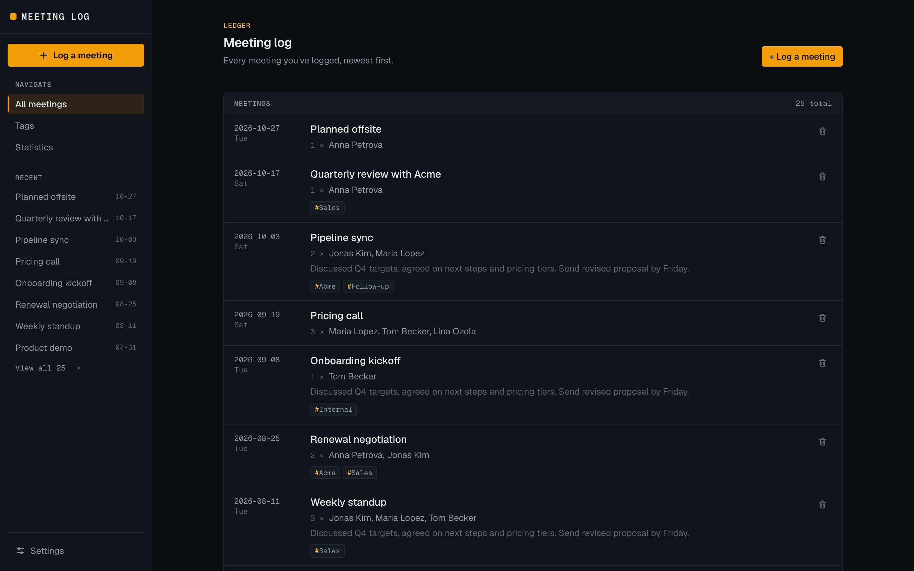

# Meeting log

A simple CRM for logging meetings, styled like a finance terminal. Everything is stored in your browser: there's no backend and no account.



## What it does

- **Log meetings** with a name, date, participants, notes, and tags. Each meeting has its own bookmarkable page, where you can edit or delete it.
- **Meeting log:** every meeting, newest first, with a sidebar menu showing the 8 most recent.
- **Tags:** create, rename, and delete tags on the Tags page, then pick them when logging a meeting. Renaming a tag updates it on every meeting.
- **Statistics:** meetings this month vs last month, meetings per month for the last year, who you meet most, who you haven't met in a while, and breakdowns by tag and day of the week.
- **Settings:**
  - Light, Dark, or System theme.
  - Export everything to a JSON backup file, and import it in another browser or on another device.

## How data is stored

Meetings, tags, and the theme choice are saved in the browser's `localStorage`. So:

- Data stays on the device and browser where you entered it, and `localhost:3000` and a deployed copy don't share data.
- Clearing site data, or closing a private window, erases it.
- Use **Settings → Backup** to keep a copy or move your data elsewhere.

## Run it locally

You need [Node.js](https://nodejs.org) 20.9 or newer.

```bash
npm install
npm run dev
```

Then open [http://localhost:3000](http://localhost:3000). The app starts empty; log a meeting to get going.

Other commands:

- `npm run build`: production build (`npm run start` serves it)
- `npm run lint`: run ESLint

## Built with

- [Next.js](https://nextjs.org) 16 (App Router)
- React 19
- TypeScript
- Tailwind CSS v4
- No other runtime libraries: the charts are plain CSS.

Working on the code? [`AGENTS.md`](AGENTS.md) describes the project structure, conventions, and design decisions.
